# Google AI Student Discount in Japan: The Secret Playbook for Passing SheerID Verification with a Telegram Bot

EiffelPyramid, catofnine

GPT has been making less and less sense lately, so it's time to switch to Google AI. This approach is intended to let you **get a paid Google AI Pro subscription at a low cost**, thereby unlocking access to advanced models in **Antigravity**.

Here's what you'll need to prepare in advance:

Required:

- Network environment: a Japan-based connection throughout the process

- Payment method: a cross-border payment card / virtual card that supports JPY transactions

- Telegram account: if you don't have one, you'll need to rent a foreign phone number to receive a verification code

As needed:

- Gmail mobile app: for registering a new account

- An email address you use regularly: for registering on the CDK website and purchasing a code

---

## 0. Create a Gmail Account

I **strongly recommend registering through the Gmail mobile app**: the process is more convenient, and it saves you the hassle of repeated mobile-device verification requests on a computer.

- I recommend adding **your home address information** to reduce the risk of an account suspension;

- You can skip the **recovery phone number** altogether.

---

## 1. Change Your Google Account's Associated Country to Japan

1. Visit policies.google.com/country-association-form to check the country currently associated with your account.

   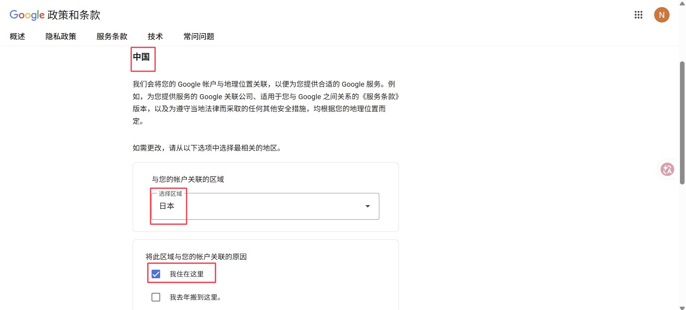

2. If the country shown isn't Japan, make the following selections at the bottom of the page:

   - **Associated country**: select Japan

   - **Reason**: select “I live here” or “I work or study in a different country than where I live”

3. Click **Submit** and wait for Google's email response.

   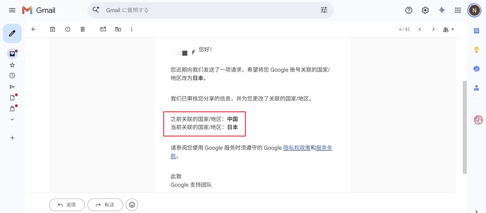

**Quick tip**: If it doesn't work the first time, try a few more times; if it keeps failing, I recommend starting over with a different account.

---

## 2. Change Your Payments Profile to Japan

1. Click your **Google profile picture** in the upper-right corner of the page, then navigate to **Google Account → Personal info → Language**.

   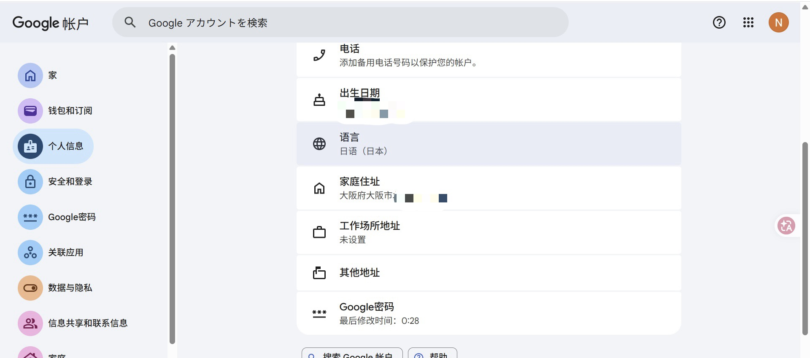

2. Change your account language to **Japanese**.

   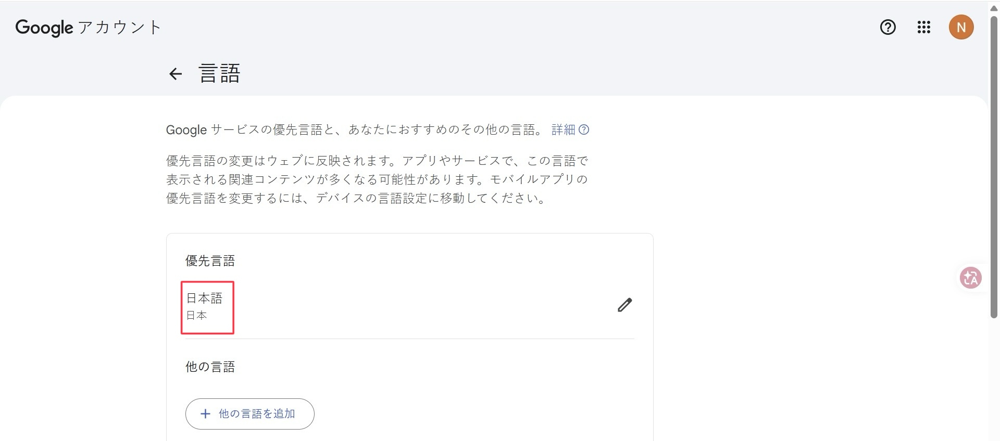

3. Visit payments.google.com and clear your old payment information first:

   - **Remove all old payment methods**: locate your existing cards and select 「削除」 (Remove).

     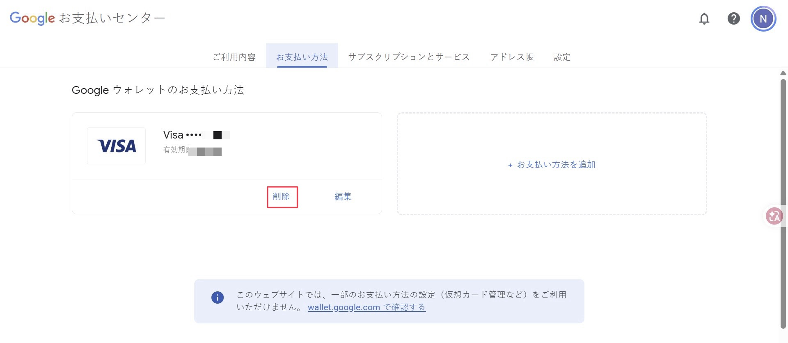

   - **Delete your old payments profile**: scroll down and select “Close payments profile.”

     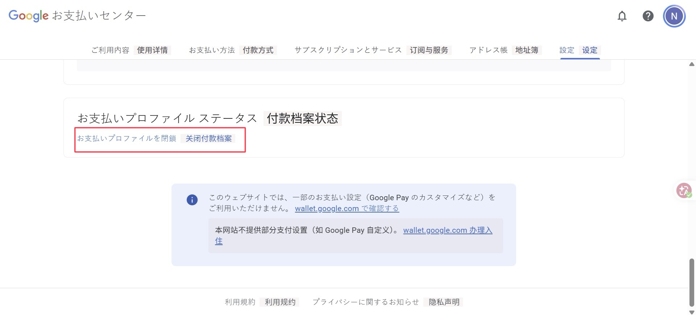

4. Click your **Google profile picture** again and navigate to **Google Account → Payments & subscriptions → Add payment method**.

   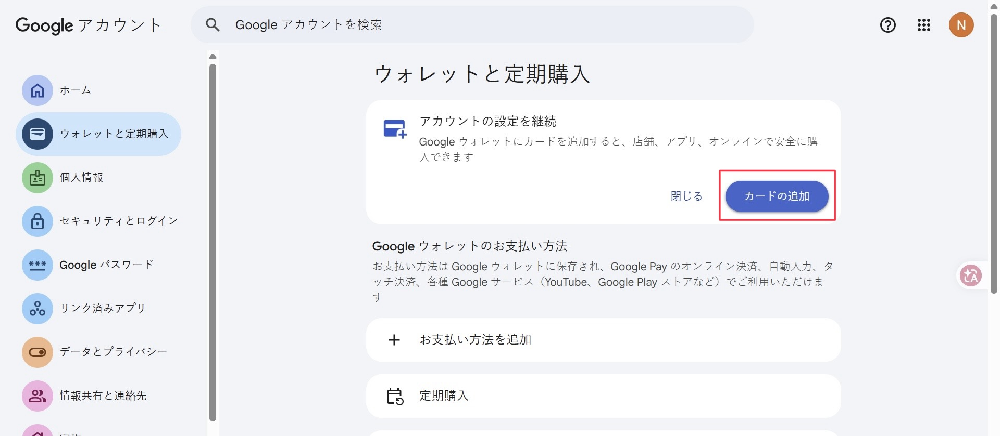

5. Add a **cross-border payment card / virtual card** (it must support JPY transactions).

   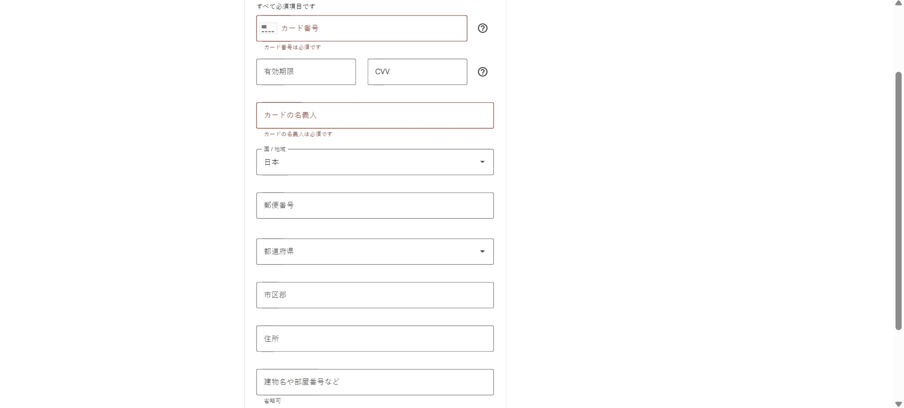

6. Enter the required card information:

   - **Cardholder name**: make sure it matches the information on the card;

   - **Billing address**: enter a Japanese address; simply copy any Japanese billing address generated by Chatbox.

     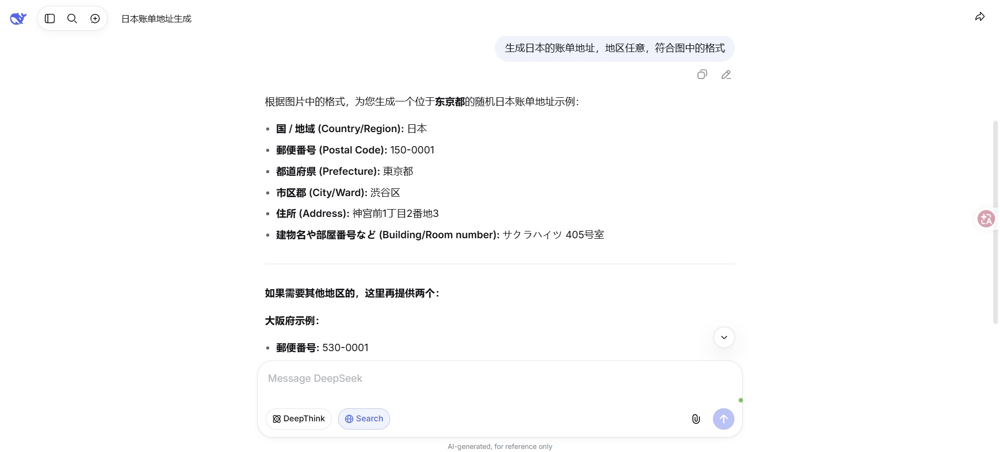

7. Double-check the information, then click **Save**.

---

## 3. Complete SheerID Student Verification with a Bot

### Step 1: Open the Student Offer Confirmation Page

1. Visit one.google.com/ai-student.

   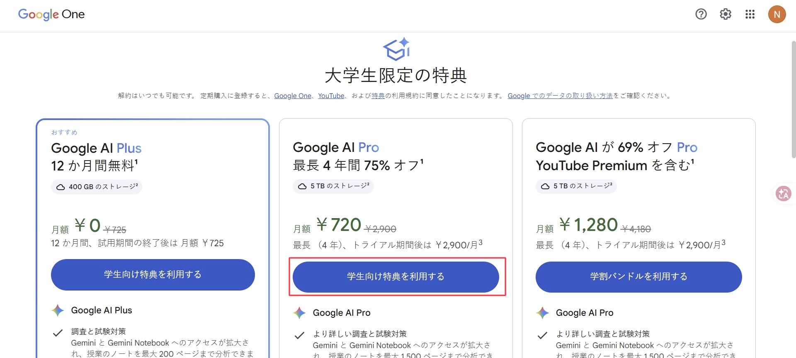

2. Click “Make the most of your student benefits” and confirm. You'll be redirected to the **student discount plan confirmation page**. **Keep this page open and don't leave it; you'll need to copy its URL later.**

   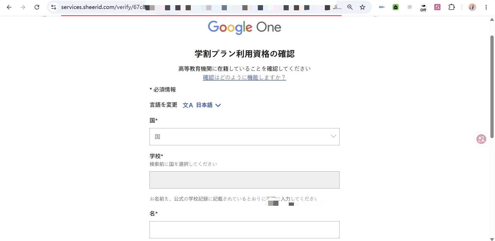

### Step 2: Prepare Telegram and a Redemption Code (CDK)

3. Sign in to **Telegram Web**.

   **Tip**: It's almost impossible to register directly with a mainland Chinese phone number, so you'll need to rent a foreign number to receive the verification code. I recommend pingme.tel, which supports web access. Just top up 2 USD using Alipay and rent a US phone number for one month.

   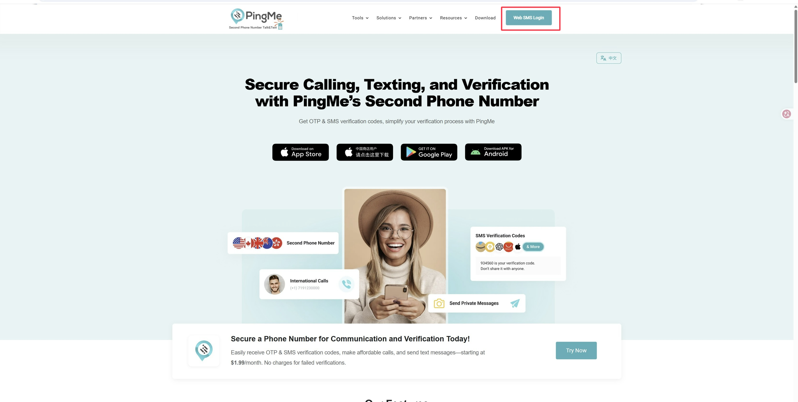

4. Visit aisuding.com and purchase a redemption code (CDK).

   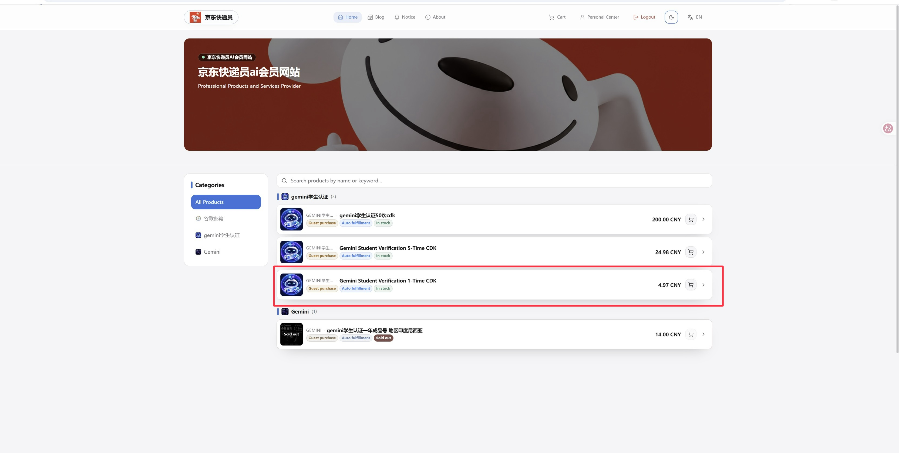

   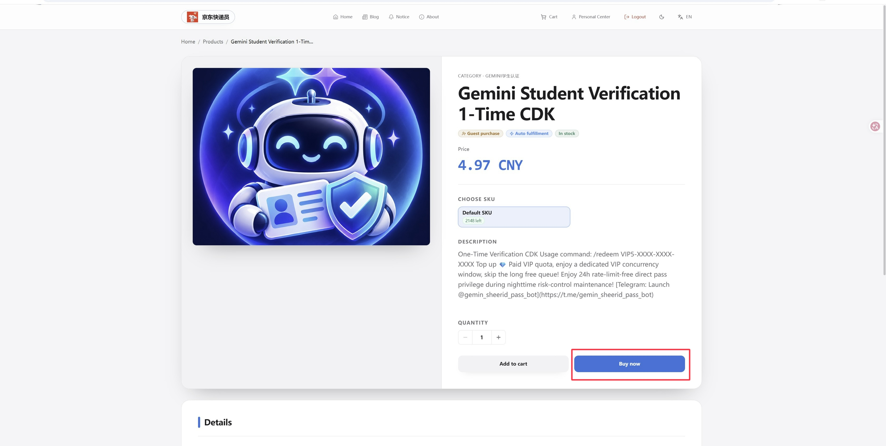

   - You'll need to register with an email address before making a purchase on this website;

   - Codes occasionally go out of stock, but they'll usually be restocked after a short wait (once maintenance is over);

   - The purchased code will look like this: VIP5-XXXX-XXXX-XXXX

### Step 3: Interact with the Bot to Complete Verification

5. While still signed in to Telegram, visit t.me/gemin_sheerid_pass_bot and click **Open in Web**.

   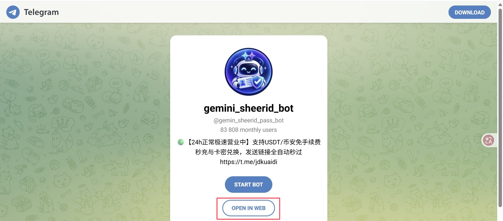

6. Once you're in the chat, follow these steps in order:

   - Enter /start;

   - Follow the prompts to join the following channels and communities, and make sure the bot isn't currently undergoing maintenance:

     - t.me/jdkuaidi

     - t.me/jdkdiyuan

       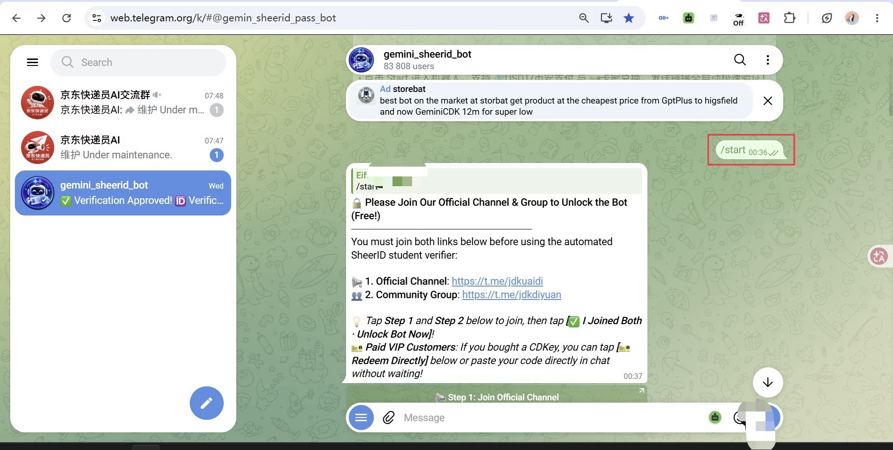

   - Enter /redeem and send the redemption code you just purchased, VIP5-XXXX-XXXX-XXXX;

     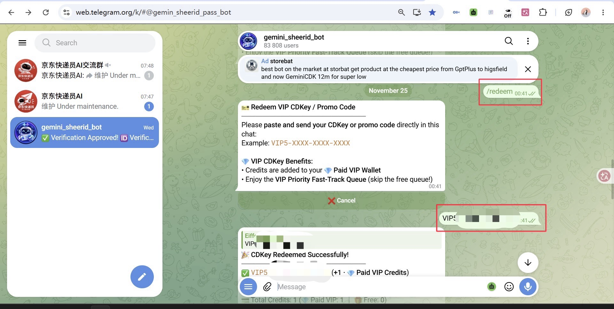

   - Enter /verify;

     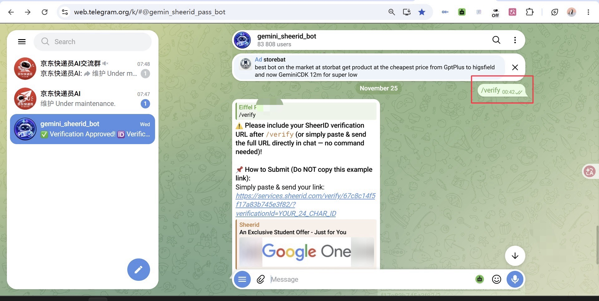

   - Return to the student discount plan confirmation page you kept open, copy its URL, and send it to the bot;

   - Wait for about **one minute**, during which the bot will display a progress bar.

     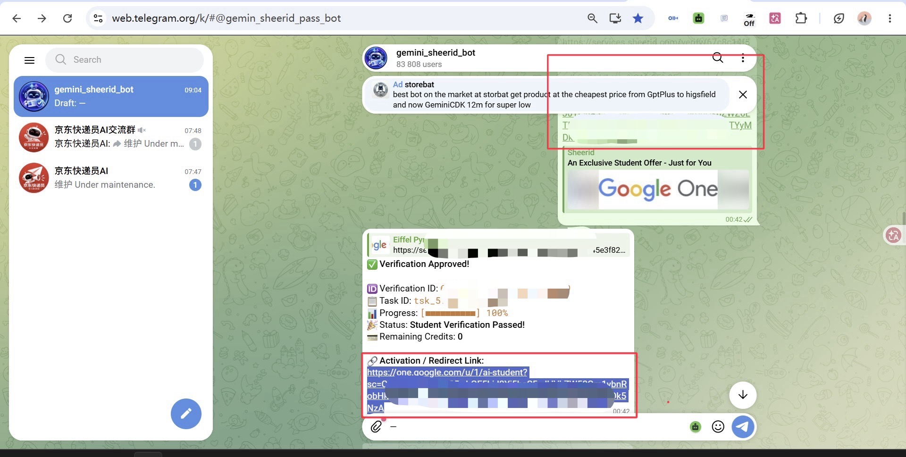

### Step 4: Complete Your Subscription

7. Copy the new URL returned by the bot and paste it into your browser to open it. You should now see the **discounted price**.

   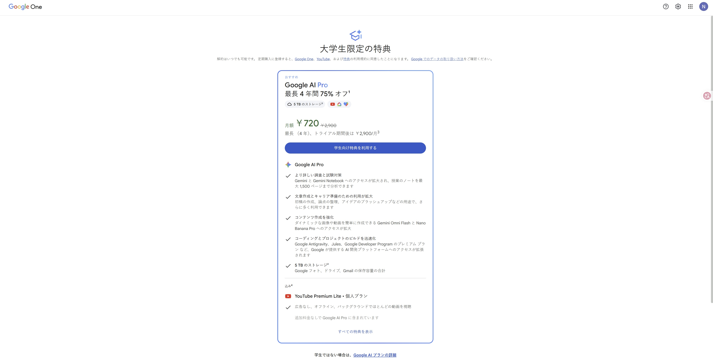

8. Click “See more plans,” select a subscription, and **you're all set!**

   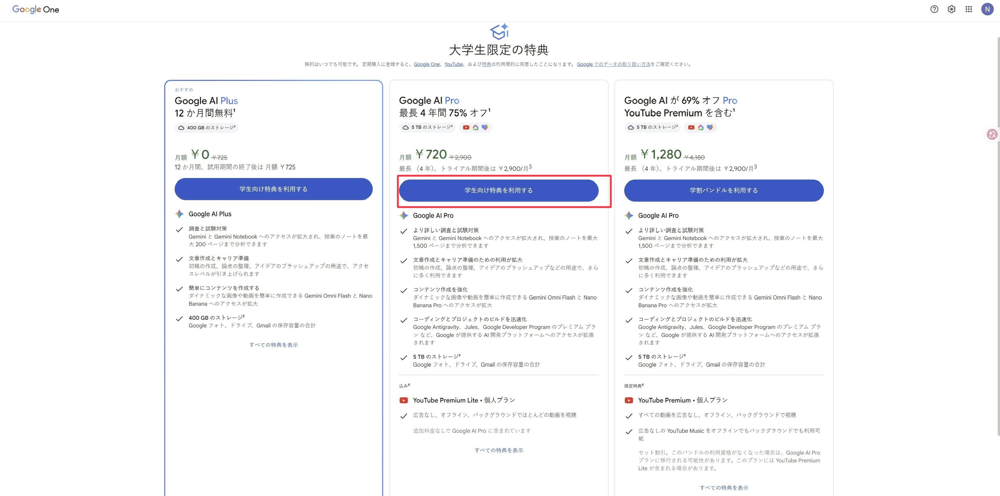

   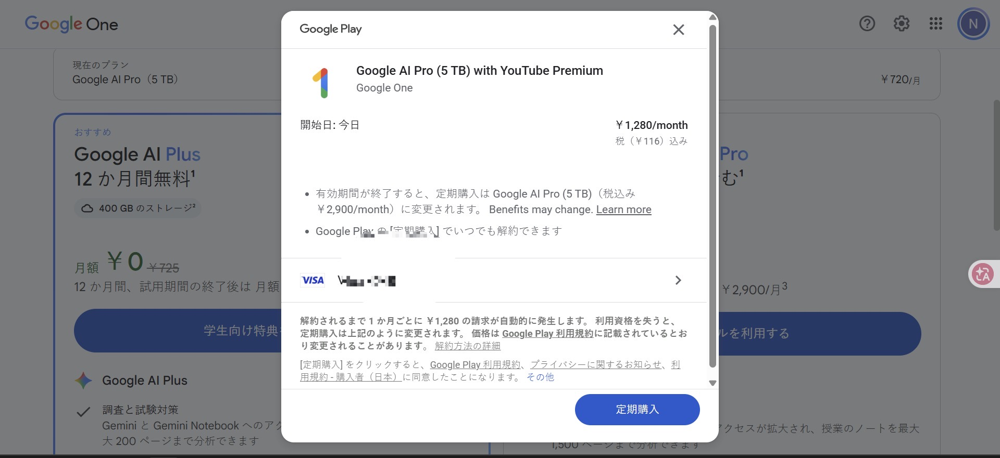

---

## 4. Using Antigravity

To be continued... Pausing the guide here for now — I've got class!
