# Google AI日区学生优惠订阅焚决：tg bot过sherrid认证教程

EiffelPyramid, catofnine

近来 GPT 愈发不讲人话，是时候转向 Google AI 了。这套方案旨在**低成本且付费订阅 Google AI Pro**，从而解锁 **Antigravity** 的高级模型使用权限。

需要提前准备以下内容：

必备：

- 网络环境：全程日本节点

- 支付工具：一张支持日元结算的跨境支付卡 / 虚拟卡

- Telegram 账号：若无账号，需要租用国外号码接码

按需准备：

- 手机Gmail App：用于注册新号

- 常用邮箱：用于在卡密网站注册购买 CDK

---

## 0. 创建 Gmail 账号

此处**强烈建议使用手机端 Gmail App 进行注册**：流程更便捷，且能省去电脑端反复要求手机设备验证的麻烦。

- 建议补充**家庭住址信息**，降低账号被封风险；

- **辅助电话号码**可以直接跳过。

---

## 1. 修改 Google 账号关联地区为「日本」

1. 访问 policies.google.com/country-association-form，检查当前账号的关联地区。

   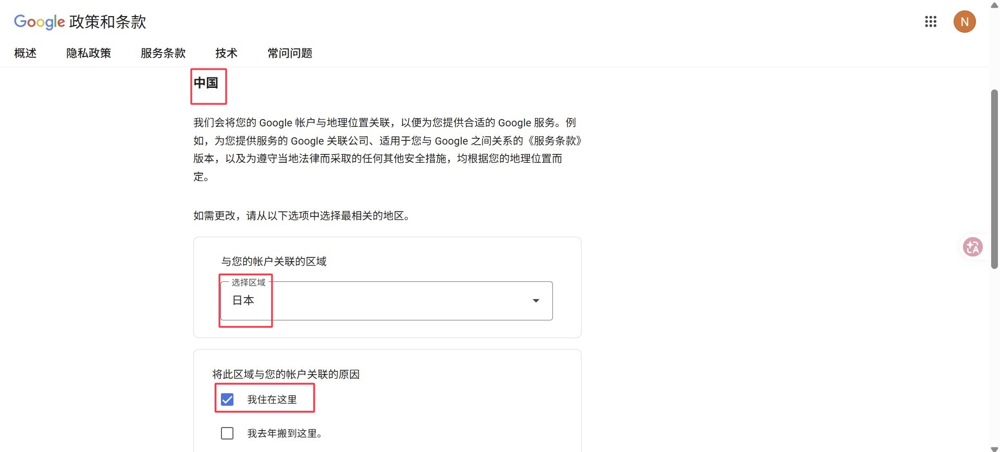

2. 如果显示的不是日本，在页面下方进行如下选择：

   - **关联地区**：选择「日本」

   - **原因**：选择“我住在这里”或“我的工作地点/学习地和居住地分属不同的地区”

3. 点击**提交**，等待 Google 的邮件回复。

   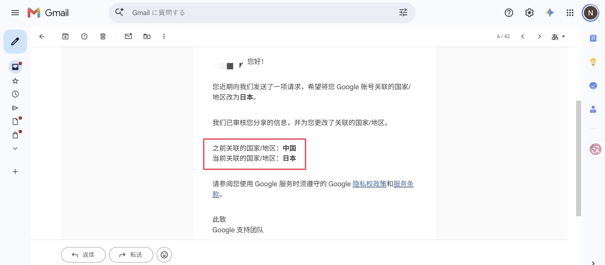

**小提示**：如果一次没有成功，可以多尝试几次；如果反复失败，建议直接换号重来。

---

## 2. 修改支付资料为「日本」

1. 点击页面右上角的 **Google 头像**，依次进入：**Google 账号 → 个人信息 → 语言**。

   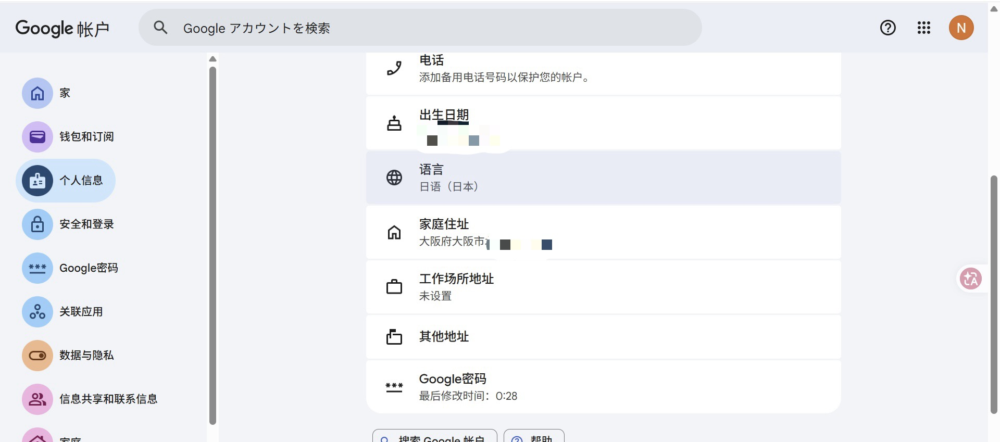

2. 将账号语言切换为**日语**。

   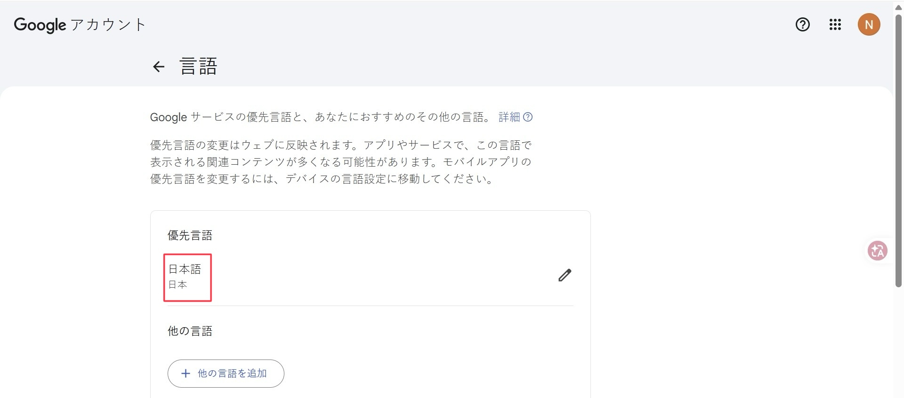

3. 访问 payments.google.com，先清理旧的付款信息：

   - **删除所有旧付款方式**：找到已有卡片，选择「削除」。

     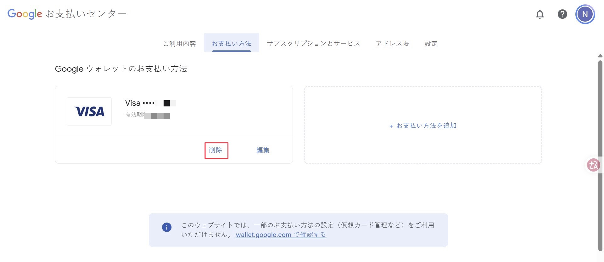

   - **删除旧支付资料**：下滑页面，选择「关闭支付资料」。

     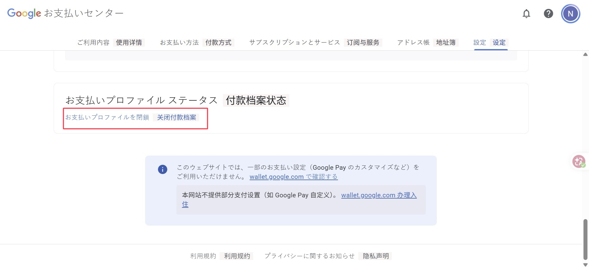

4. 再次点击 **Google 头像**，依次进入：**Google 账号 → 钱包与订阅 → 添加付款方式**。

   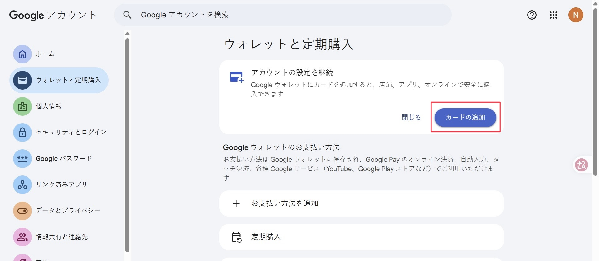

5. 添加一张**跨境支付卡 / 虚拟卡**（需支持日元结算）。

   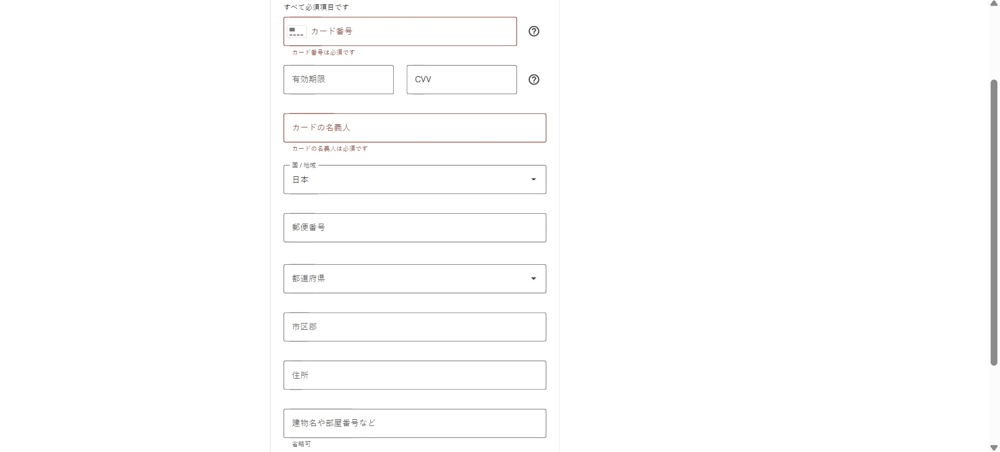

6. 按要求填写卡片信息：

   - **持卡人姓名**：与卡面信息保持一致；

   - **账单地址**：填写日本地址，直接复制任意 Chatbox 生成的日本账单地址即可。

     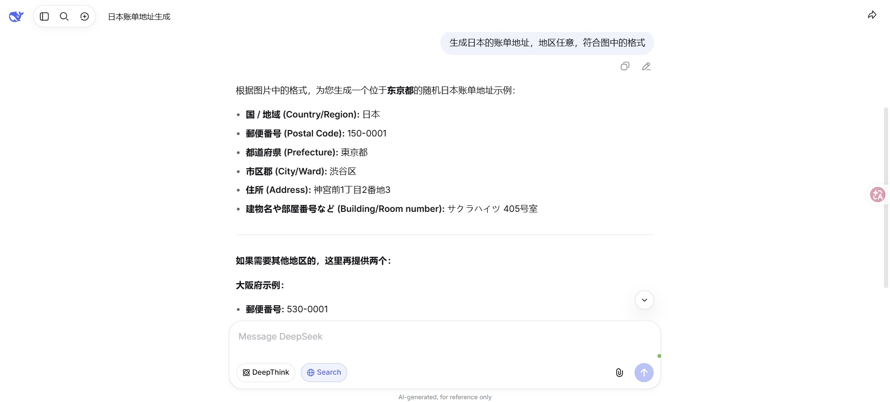

7. 核对无误后，点击**保存**。

---

## 3. 通过 Bot 完成 SheerID 学生认证

### 第一步：打开学生优惠确认页

1. 访问 one.google.com/ai-student。

   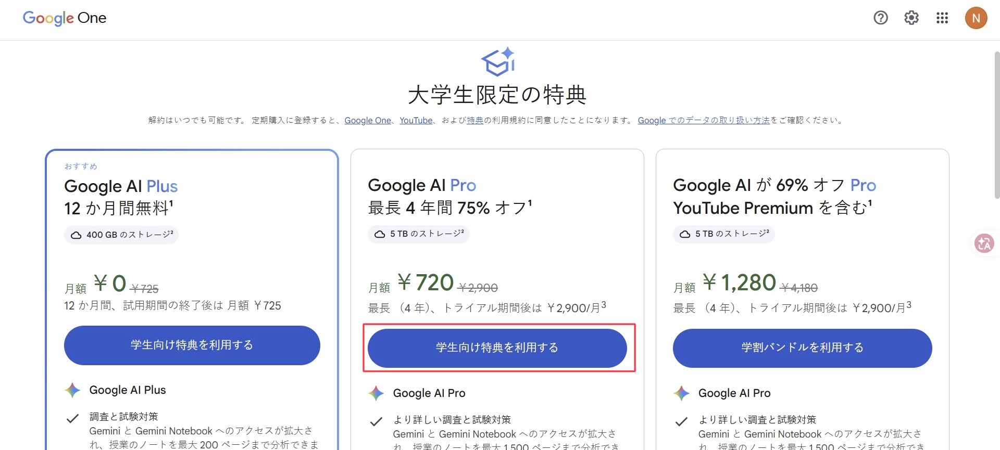

2. 点击「充分利用学生福利」并确认，页面会跳转至**学生折扣计划确认页**，**保持这个页面打开，不要退出，之后需要复制该网页链接**。

   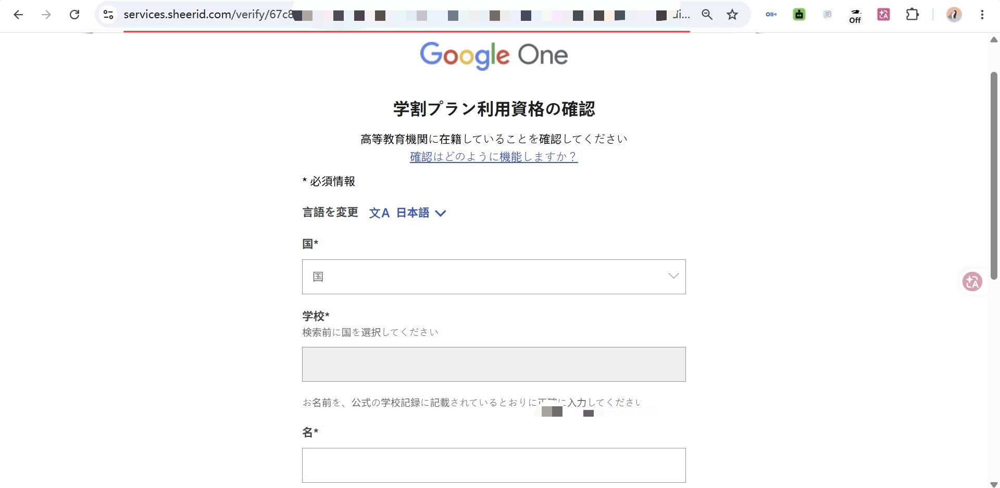

### 第二步：准备 Telegram 与卡密（CDK）

3. 登录 **Telegram Web**。

   **提示**：大陆手机号几乎无法直接注册，需要租用国外手机号接收验证码。这里推荐支持网页登录的 pingme.tel，用支付宝充值 2 USD，租用一个月的美国号码即可。

   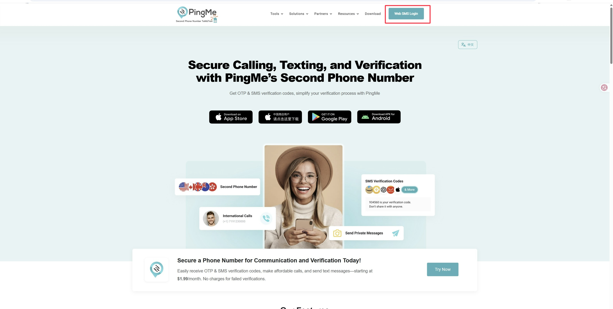

4. 访问 aisuding.com 购买一个卡密（CDK）。

   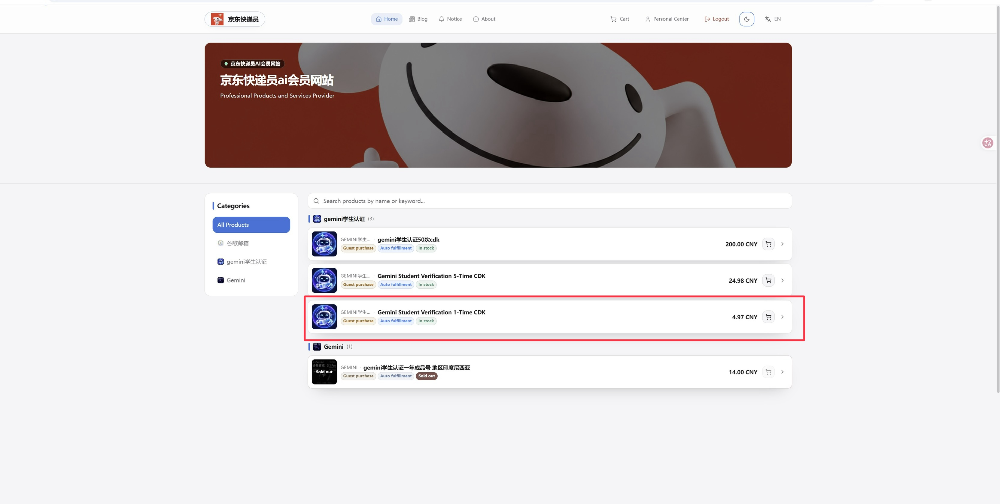

   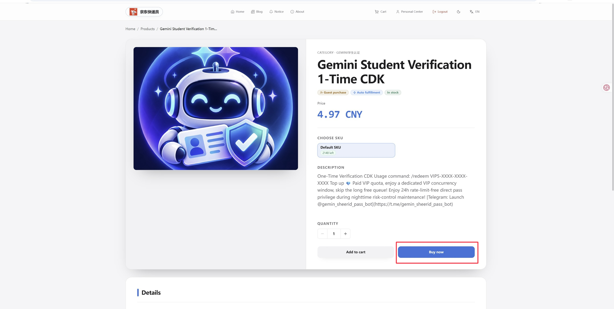

   - 该网站购物需先用邮箱注册；

   - 偶尔会遇到缺货情况，通常等一会儿（维护期过后）就会补货；

   - 购买后的卡密格式如下：VIP5-XXXX-XXXX-XXXX

### 第三步：与 Bot 交互完成认证

5. 在保持 Telegram 登录的状态下，访问 t.me/gemin_sheerid_pass_bot，点击 **Open in Web**。

   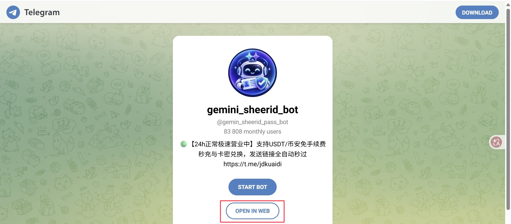

6. 进入对话界面后，按以下顺序操作：

   - 输入 /start；

   - 按提示加入以下频道和社区，同时确认 Bot 当前不处于维护期：

     - t.me/jdkuaidi

     - t.me/jdkdiyuan

       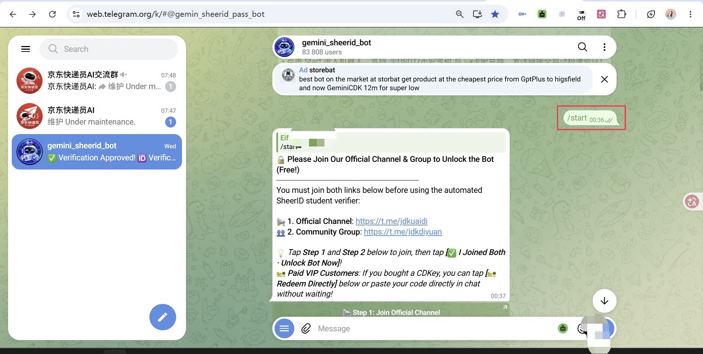

   - 输入 /redeem，并发送刚刚购买的卡密 VIP5-XXXX-XXXX-XXXX；

     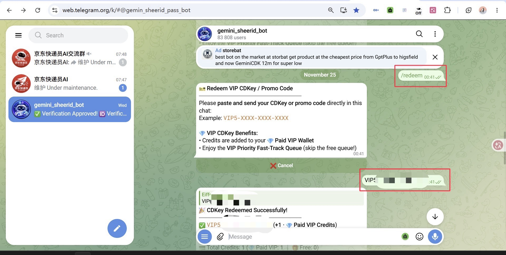

   - 输入 /verify；

     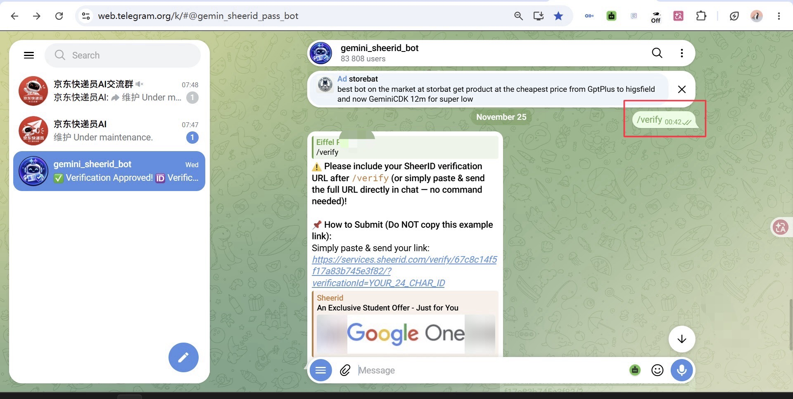

   - 回到刚才保留的「学生折扣计划确认页」，复制该页面链接发送给 Bot；

   - 等待约 **1 分钟**，期间 Bot 会显示处理进度条。

     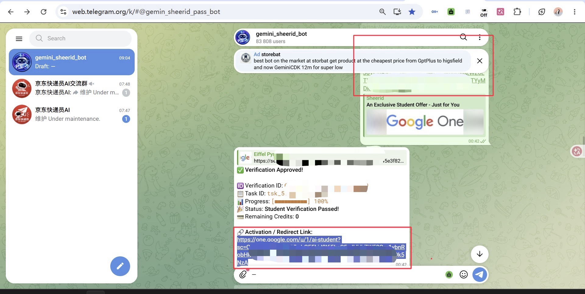

### 第四步：完成订阅

7. 复制 Bot 输出的新网页链接，粘贴到浏览器中打开，此时页面会出现**优惠价格**。

   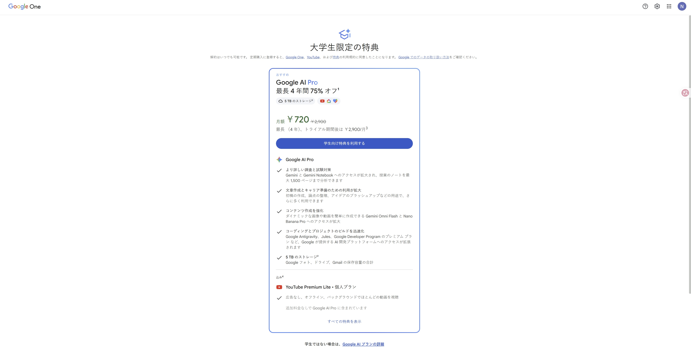

8. 点击「查看更多方案」，选择订阅，**大功告成！**

   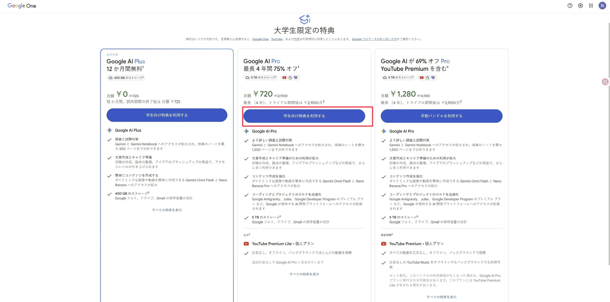

   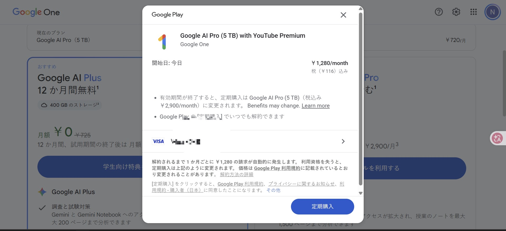

---

## 4. 使用 Antigravity

待续……攻略先暂停，去上课！
